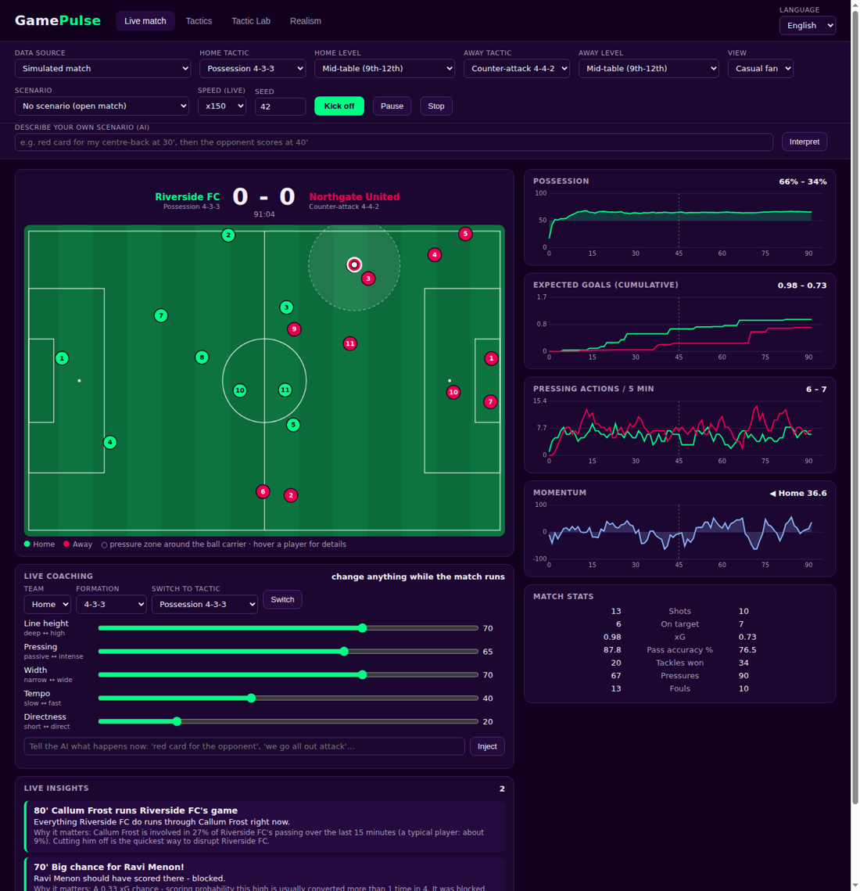
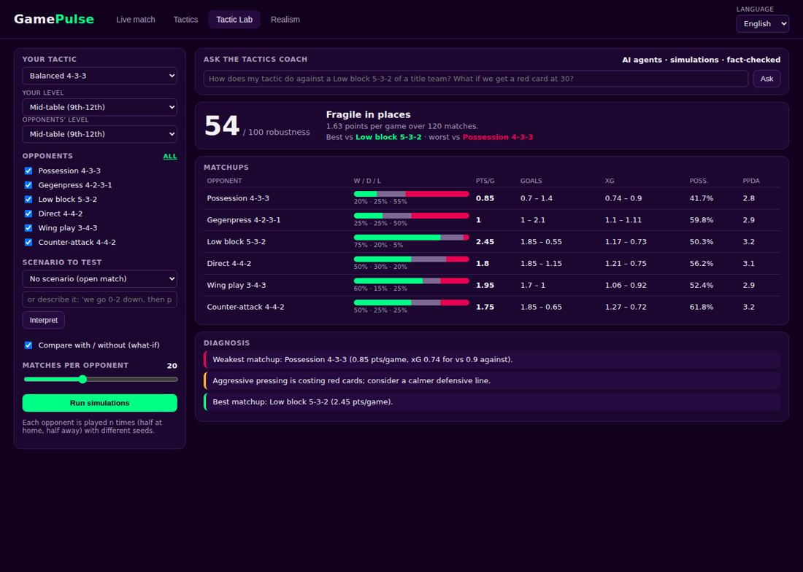
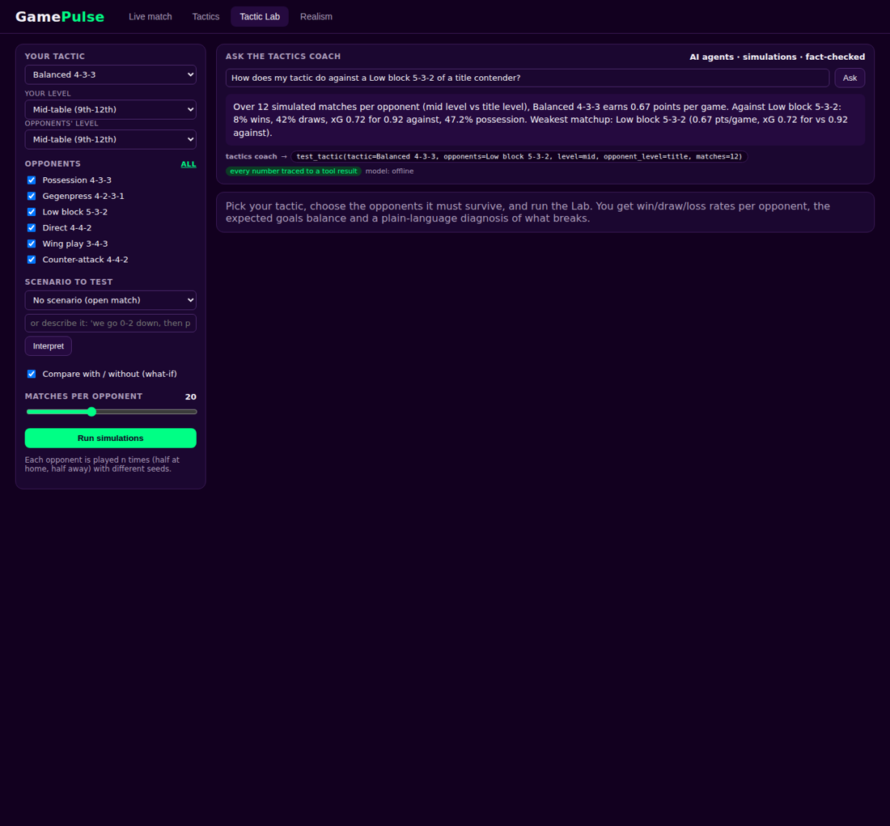
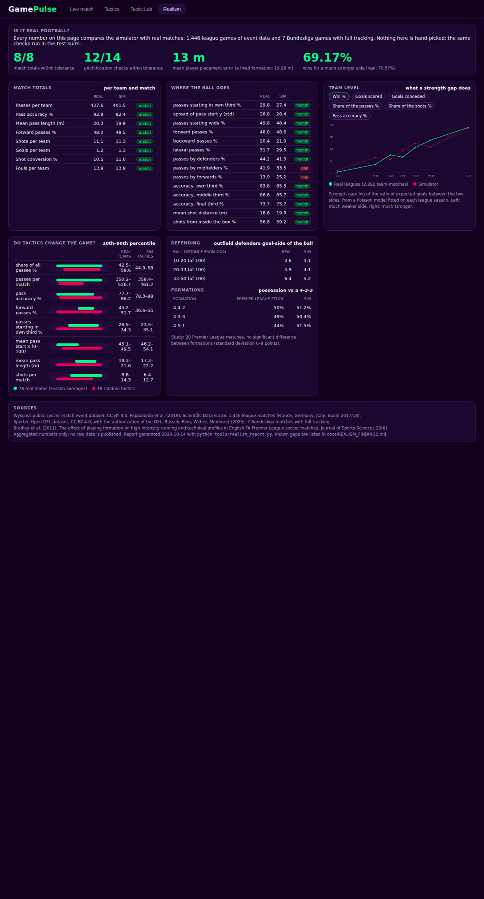

# GamePulse

**Feel the match, understand the moment.**
AI match intelligence and a tactical lab for football: multi-agent explanations of what happens on the pitch, in the viewer's language,
and a match simulator a coach can trust because every number is checked against real football.

**[▶ Live demo](https://gamepulse.lemonbay-43a4c2ef.polandcentral.azurecontainerapps.io)** · Demo video: *link added at submission* ·
Built for the *Inside the Game: Developer Hackathon* (Microsoft x Premier League).



## What it does
**For fans and broadcasters** (Live match tab)
- A match plays live: 22 players on the pitch, possession, expected goals, pressing and momentum charts.
- Agents detect what the TV does not show (a team dominant but not rewarded, a pressing that fades, the player everything goes
  through, the turning point after a tactical change) and **explain why it matters**, citing the events behind every claim.
- **English, French, Spanish, Arabic** (right-to-left): the whole interface, the insights and the agents' answers. Casual or analyst
  view, favourite team, follow a player.
- **Ask the match analyst** anything about the match; it answers from the engine's numbers.
- Works on simulated matches **and on real matches** (public Wyscout data, pseudonymised), through the same event contract.
- Every insight is also exported as **timestamped overlay JSON** for a broadcast renderer (`/api/overlay`).

**For coaches** (Tactics and Tactic Lab tabs)
- 75 formations, a role per player (or **described in plain words** and translated by the AI), five team instructions.
- Choose **your level and the opponent's** (from title contender to relegation battle, calibrated on real leagues).
- Run hundreds of matches against other tactics: wins, draws, losses, expected goals, possession, PPDA and a plain diagnosis.
- **What-if**: the same matches with and without a scenario ("red card at 30'", "we switch to 5-4-1 at 70' if we lead").
- **Coach live** while the match runs, or **ask the tactics coach**, which answers by running the simulations.



## Built on Microsoft
| Technology | How GamePulse uses it |
|---|---|
| **Microsoft Agent Framework** | Match Analyst and Tactics Coach agents with function tools, a router, and a fact-checker on every answer (`gamepulse/agents/team.py`). |
| **Microsoft Foundry / Azure OpenAI** | `gpt-4.1-mini` **fine-tuned** into a GamePulse commentator (4 languages, grounded), deployed with the DefaultV2 guardrails. |
| **MCP** | The engine, the Lab and the agents as MCP tools: `python -m gamepulse.mcp_server`, or `/mcp/` on the live app. |
| **Azure Container Apps** | The live demo (scale to zero), image built by GitHub Actions; a managed identity keeps the model deployed. |
| **GitHub** (Actions, Container Registry) | Every push to `main` builds and publishes the container image. |

```
 feed (simulator | real match) ─> event contract ─> Stats ─> Moment detectors ─> Explainer ─> Narrator ─> Fact-checker ─> Persona ─> overlay JSON / UI
 question ─> Router ─┬─> Match Analyst  (match_snapshot, key_moments, player_report, top_players)
                     └─> Tactics Coach  (test_tactic, what_if, list_tactics, realism)  ─> Fact-checker ─> answer + tool trace
```



## Why you can trust it
**The numbers come from the engine, never from the model.** The model plans tool calls and writes; a fact-checker rejects any sentence
containing a number that is not in the tool results. Evaluation of the fine-tuned model on matches it never saw
(`tools/eval_model.py`): **40/40 overlay sentences grounded and in the right language** (English, French, Spanish, Arabic), **6/6 agent
answers grounded**.

**The simulator is validated against real football**, and the app shows it (Realism tab):
- match totals (passes, accuracy, shots, goals, conversion, fouls): **8/8** within tolerance of 1,446 real league matches;
- where the ball goes (thirds, flanks, direction, accuracy by zone, shot locations): **14/16** checks;
- player placement against real tracking (7 Bundesliga matches): **13 m** mean error, against 20 m for a fixed formation;
- team level: a strength gap changes wins, goals and shots as it does in real leagues (Poisson strength model);
- tactics change the game as much as real teams differ (pass share, accuracy, shots).

Known gaps are listed, not hidden: `docs/REALISM_FINDINGS.md`.



## Run it
```bash
pip install -r requirements.txt
python tools/fetch_wyscout.py && python tools/split_wyscout.py   # optional: real matches (public Wyscout data, CC BY 4.0)
uvicorn gamepulse.api.server:app --port 8000                     # open http://localhost:8000
python -m pytest -q -p no:anyio tests                             # 40 tests, offline
```
Without Azure credentials everything runs offline: the same agents and tools, with a deterministic planner in place of the model.
To use the fine-tuned model, set `AZURE_OPENAI_ENDPOINT`, `AZURE_OPENAI_API_KEY` and `AZURE_OPENAI_DEPLOYMENT` (see `.env.example`).
Container: `docker build -t gamepulse .`. MCP: `python -m gamepulse.mcp_server` (stdio) or the `/mcp/` endpoint.

## Data and licences
- Clubs and players of simulated matches are fictional. Real matches are **pseudonymised** (no real player or club names are shown).
- Wyscout public dataset: Pappalardo et al. (2019), *A public data set of spatio-temporal match events in soccer competitions*,
  Scientific Data 6:236, CC BY 4.0.
- Sportec Open DFL dataset: Bassek, Rein, Weber, Memmert (2025), CC BY 4.0, with the authorization of the DFL.
- Raw data is never committed; only aggregated statistics are published. Details: `docs/DATA_SOURCES.md`.

## Repository
| Path | What |
|---|---|
| `gamepulse/simulator/` | Tactical match simulator (positions, passing, pressing, shots, fatigue, scenarios, team levels) |
| `gamepulse/engine/` | Live statistics, momentum, moment and insight detectors |
| `gamepulse/agents/` | Agents (Agent Framework), tools, model clients, fact-checker, overlay chain, AI interpreter |
| `gamepulse/feed/` | Event contract and feeds: simulator, Wyscout, Sportec |
| `gamepulse/mcp_server.py` | MCP server |
| `gamepulse/lab.py`, `strength.py`, `styles.py`, `spatial.py`, `calibration.py`, `validation.py` | Tactic Lab and the realism checks |
| `web/` | Single-page app (4 languages) |
| `tools/` | Data download, fine-tuning data, model evaluation, realism report, tuning |
| `docs/` | `AGENTS.md`, `REALISM_FINDINGS.md`, `EVENT_CONTRACT.md`, `OVERLAY.md`, `DATA_SOURCES.md`, `CALIBRATION.md` |

## Team
Wael Akhdar and Jessim Ziani (EPITA).
